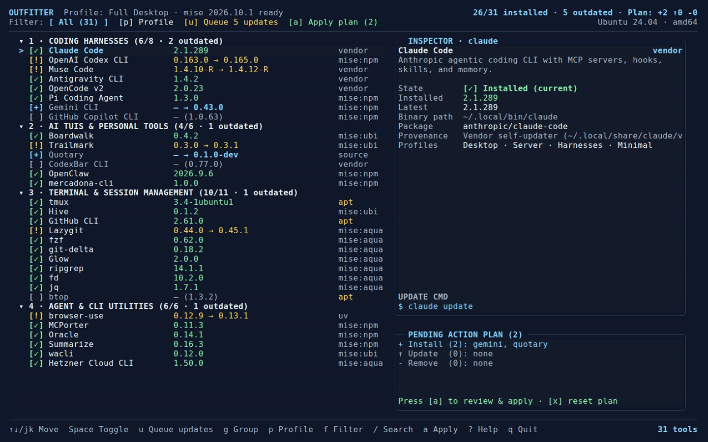

# Outfitter

**Your AI development toolkit, installed and kept current.**

Outfitter lets you bootstrap, inspect, select, and bulk-update the command-line coding agents, personal AI TUIs, and terminal tools you rely on for AI-assisted software development on Debian and Ubuntu Linux — all from your shell, at keyboard speed.

It wraps [`mise`](https://mise.jdx.dev) (managing `aqua`, `ubi`, GitHub Releases, `npm`, and `uv` tools plus isolated Node and Python runtimes) alongside thin adapters for Debian/Ubuntu `apt` packages, local Go source builds, and self-updating vendor harnesses (`claude`, `muse`, `agy`, `opencode`, `codexbar`).



*Recorded from the application using fictional tool states (`outfitter --demo`). [Recreate the demo](tapes/README.md).*

## Install

1. Download the binary for your Linux system (`amd64` or `arm64`) from the [latest release](https://github.com/juanrubio/outfitter/releases/latest), verify it against `SHA256SUMS`, make it executable, and place it on your `PATH` (for example `~/.local/bin/outfitter`).
2. Confirm with `outfitter --version`. Release binaries are standalone and do not require Go or `mise` pre-installed.

If `mise` is not yet installed on a fresh Debian or Ubuntu machine, Outfitter automatically downloads the official `mise` release archive, verifies its SHA-256 digest against `SHASUMS256.txt`, and installs `~/.local/bin/mise` (`0755`) as Step 0 of your first plan. When `gh` (GitHub CLI) is installed and logged in, Outfitter also borrows `gh auth token` for upstream GitHub Release checks so version discovery never hits anonymous rate limits.

Prefer building from source? With Go installed: `go build -o outfitter ./cmd/outfitter` (or `make build`).

## Quick start

```sh
outfitter                                  # open the interactive TUI
outfitter --demo                           # explore with offline fictional data
```

Inside the TUI, everything is keyboard-driven and the footer always shows the keys that matter right now. Press `?` any time for the full shortcut reference. The keys you will use most:

| Key | What it does |
|---|---|
| `↑↓` or `j` / `k` | Move between tools |
| `1` – `5` | Jump to a category (`All`, `Coding Harnesses`, `AI TUIs`, `Terminal & Shell`, `CLI Utilities`) |
| `Tab` / `Shift+Tab` | Switch focus between the tool list, category bar, and detail pane |
| `[` / `]` | Cycle preset profiles (`Full Desktop`, `Headless Server / VPS`, `Coding Harnesses Only`, `Minimal Core`) |
| `Space` | Toggle action for the selected tool (`[+] Install`, `[↑] Update`, `[-] Remove`, or clear) |
| `u` | Queue updates for all outdated tools |
| `i` | Queue installs for all missing tools in the current view |
| `a` | Toggle all visible tools in the current view |
| `/` | Filter tools by name, binary, package, or description |
| `Enter` | Open the **Dry-Run Plan Review** modal to inspect exact `$ <cmd>` steps and confirm execution |
| `t` | Cycle color themes (`Midnight`, `Daylight`, `Dracula`, `Nord`, `Monochrome`) |
| `r` | Refresh installed and upstream versions |
| `?` | Open the keyboard shortcut reference |
| `q` | Quit Outfitter |

Outfitter opens immediately from a local state snapshot (`~/.cache/outfitter/state.json`) and refreshes in the background, so you are never staring at a blank terminal. Selecting or deselecting tools only mutates an in-memory **Pending Action Plan** (`+N install`, `↑N update`, `-N remove`) — nothing on disk is touched until you press `Enter` and confirm on the Dry-Run Plan Review screen.

## From the command line

The same catalog, profile, and update workflows work as scriptable commands with deterministic exit codes (`0` success, `1` partial/complete tool failure, `2` usage error or unconfirmed non-interactive pipe):

```sh
outfitter status                           # list all tools, installed versions, provenance, and updates
outfitter check                            # query upstream registries for available updates
outfitter profile list                     # list built-in and custom profiles
outfitter profile apply server --yes       # bootstrap a headless VPS profile non-interactively
outfitter install claude-code codex --yes  # install specific tools
outfitter update --all --yes               # bulk-update every outdated tool
outfitter remove aider --yes               # uninstall specific tools
outfitter catalog export > ~/.config/outfitter/catalog.toml
```

Every mutating command first builds the ordered execution plan. Preview safely with `--dry-run`; in scripts, pass `--yes` to confirm (without it, a piped command that would modify your system prints the dry-run plan and exits with code `2`). Add `--json` when a script needs structured machine-readable output.

## Customizing your catalog (`catalog.toml`)

Outfitter ships with **39 curated tools** across 4 categories and 4 profiles (`desktop`, `server`, `harnesses`, `minimal`). You can override any built-in tool, add your own tools, or define custom machine profiles in `~/.config/outfitter/catalog.toml` (or pass `--catalog /path/to/catalog.toml` from your dotfiles repository):

```toml
# Override a built-in tool to build from local source while developing
[[tools]]
id = "quotary"
backend = "source"
source_dir = "~/repos/quotary"
build_cmd = "go build -o ~/.local/bin/quotary ./cmd/quotary"

# Add a custom tool to the catalog
[[tools]]
id = "ttyd"
name = "ttyd"
category = "terminal"
binary = "ttyd"
backend = "mise:ubi"
package = "tsl0922/ttyd"
profiles = ["desktop", "server"]
description = "Share terminal sessions over the web"

# Define a custom profile
[profiles.vps-worker]
name = "VPS Worker"
short = "VPS"
description = "Headless agent worker for Hetzner VPS"
tools = ["tmux", "gh", "claude-code", "codex", "openclaw", "boardwalk", "ripgrep", "jq"]
```

## Good to know

- **No disappearing NPM harnesses.** Node-based coding agents (`codex`, `pi`, `gemini-cli`, `copilot-cli`, `openclaw`, `mcporter`, `oracle`, `summarize`) run on a `mise`-managed Node LTS runtime with stable shims, so switching project Node versions in `nvm` never breaks your global AI CLIs.
- **Per-tool failure isolation and structured logs.** If one upstream installer fails during a bulk update, Outfitter records its exit code and continues updating the remaining independent tools. Every run writes a full timestamped log to `~/.local/state/outfitter/logs/run-<timestamp>.log`.
- **Companion bundle support.** Native vendor installers handle special layouts automatically — including extracting `codexbar`'s `CodexBarCLI` executable alongside its required `CodexBarCLI_CodexBarCore.bundle` into `~/.local/share/outfitter/codexbar/` and symlinking `~/.local/bin/codexbar`.

## Contributing — humans and AI tools welcome

Outfitter itself was built with AI assistance, and contributions made that way are welcome here. Point your coding agent — or yourself — at [AGENTS.md](AGENTS.md): it has the map of the repo, how to build and verify, and the rules that aren't obvious from the code. Contributions are judged on the change itself: specs respected, `make check` green. For anything bigger than a small fix, an issue first saves everyone time; [CONTRIBUTING.md](CONTRIBUTING.md) walks through the loop.

## Documentation and development

- [Product & technical specification](docs/specs/product.md) and the [TUI specification](docs/specs/tui.md) describe the exact architecture, catalog schema, keyboard state machine, and CLI contract; the [documentation index](docs/README.md) links all project records.
- [Interactive HTML mockup](docs/mockups/index.html) — open locally in a browser to explore the character-grid reference across terminal sizes and themes (`Midnight`, `Daylight`, `Monochrome`) with zero network dependencies.
- [Traceability matrix](docs/evidence/traceability.md) maps every product and TUI requirement to its implementation and offline tests.
- [VHS tapes](tapes/README.md) hold the scripted showcase recording used for the README animation above.
- Hacking on it: `make check` runs `go vet`, the pinned `golangci-lint`, `docs-check`, and the full offline test suite; `make race` runs tests under the Go race detector; `make build` builds `./outfitter`.

## License

[MIT](LICENSE) © Juan A. Rubio
