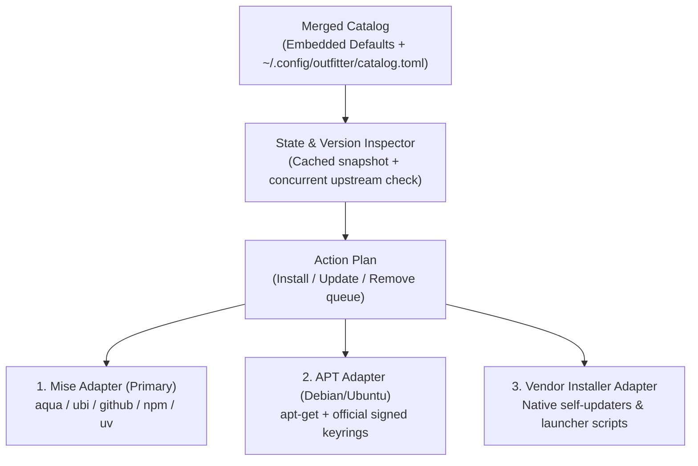

# Outfitter — Product and Technical Specification

- **Working name:** Outfitter (`outfitter`)
- **Status:** Draft v1
- **Date:** 2026-10-19
- **Platform:** Debian and Ubuntu Linux (`amd64`, `arm64`)
- **Interaction specification:** [UX.md](UX.md)
- **Interactive design reference:** [docs/mockups/index.html](docs/mockups/index.html)

---

## 1. Summary

**Outfitter** is a keyboard-first TUI and scriptable CLI for installing, inspecting, selecting, and bulk-updating the command-line tools and coding harnesses used for AI-assisted software development on Debian and Ubuntu Linux.

An AI development environment today spans incompatible installation channels: coding harnesses (`claude`, `codex`, `muse`, `agy`, `opencode`, `pi`, `gemini`, `copilot`), terminal workspaces (`tmux`, `hive`, `lazygit`), personal AI TUIs (`boardwalk`, `trailmark`, `quotary`, `codexbar`, `openclaw`, `mercadona-cli`), Python/uv agent tools (`browser-use`), and system utilities (`gh`, `fzf`, `delta`, `glow`, `ripgrep`, `fd`, `jq`, `btop`). Keeping these installed and updated across desktop workstations and headless Ubuntu servers requires remembering a half-dozen package managers, vendor scripts, and Node/Python runtime quirks.

Outfitter provides:
1. **A curated, extensible catalog** organized into four categories (**Coding Harnesses**, **AI TUIs & Personal Tools**, **Terminal & Session Management**, and **Agent & CLI Utilities**) with built-in selection profiles (**Full Desktop**, **Headless Server / VPS**, **Harnesses Only**, **Minimal**).
2. **A `mise`-backed installation engine** that auto-bootstraps `mise` into `~/.local/bin/mise` (with SHA-256 verification) when missing, using `mise` to manage GitHub releases (`aqua:` / `ubi:`), NPM global CLIs (`npm:`), Python tool environments (`pipx:` / `uv`), and language runtimes—so Node-based harnesses like `codex` and `pi` never disappear when switching project Node versions.
3. **Thin, explicit adapters** for the two places `mise` does not cover: Debian/Ubuntu `apt` packages (`tmux`, `gh`, `btop`) and self-managing vendor installers (`claude`, `muse`, `agy`, `opencode`).
4. **A two-phase Plan & Apply workflow**: select or deselect tools visually in the TUI, mark outdated tools for upgrade, inspect the exact commands that will run in a dry-run execution plan, and execute them with live per-tool progress and logs.

---

## 2. Goals and Non-Goals

### Goals (v1)
- **Zero-prerequisite bootstrap on Debian/Ubuntu:** Drop the standalone `outfitter` binary onto a fresh Ubuntu or Debian machine, run `outfitter`, and let it bootstrap `~/.local/bin/mise` and your chosen tools cleanly.
- **Visual selection and bulk updates:** Browse all catalog tools grouped by category, toggle individual tools (`Space`) or entire categories (`g`), apply preset profiles (`p`), mark all outdated tools for update (`u`), and review pending changes before execution (`a`).
- **Unified version and update discovery:** Detect installed binary path, installed version, and latest upstream version in the background without blocking startup. Borrow `gh auth token` when available to avoid GitHub API rate limits.
- **User-extensible catalog:** Ship an opinionated built-in catalog embedded in the binary while allowing users to add custom tools, override backends, or define custom profiles in `~/.config/outfitter/catalog.toml`.
- **Parity between TUI and CLI:** Every action in the TUI (`status`, `install`, `update`, `remove`, `apply`, `catalog`) works as a non-interactive CLI command with `--dry-run`, `--yes`, and `--json` for scripts and provisioning pipelines.

### Non-Goals (Deferred to v2)
- **Provider authentication and credential management:** Outfitter v1 verifies whether a binary is installed and up to date; it does not run `gh auth login`, `claude login`, or OIDC flows, nor does it inspect subscription quotas (which belongs to `quotary`). Readiness/auth doctor checks are deferred to v2.
- **Dotfile and editor configuration management:** Wiring `tmax` into `~/.tmux.conf` or `blog-ai.el` into `~/.emacs` is deferred to v2.
- **Non-Debian operating systems:** While `mise`-backed tools work on macOS and other Linux distributions, `apt` system package handling in v1 targets Debian and Ubuntu specifically.
- **Background daemon or silent auto-updates:** Outfitter never installs, upgrades, or removes software without explicit user confirmation in the TUI or `--yes` on the CLI.

---

## 3. Architecture & Backend Engine

Outfitter does not reinvent package downloading where `mise` / `aqua` already excel. Every catalog entry declares a `backend` that maps to one of three execution adapters:



### 3.1 Auto-Bootstrapping `mise`
When Outfitter starts and detects that `mise` is not on `PATH` (and not at `~/.local/bin/mise`):
1. The TUI displays a clear banner (or dedicated bootstrap prompt on first apply) offering to install `mise` to `~/.local/bin/mise`.
2. Outfitter downloads the official `mise` release tarball for the host architecture (`linux-x64` or `linux-arm64`), verifies its SHA-256 checksum against the official `SHASUMS256.txt` (and GPG signature when `gpg` is present), extracts `~/.local/bin/mise`, and sets `0755` permissions.
3. When invoking `mise` for `npm:` or `pipx:`/`uv` backends, Outfitter ensures `mise` has a managed Node LTS and `uv` runtime configured in an isolated global scope (`~/.config/mise/config.toml`) so global AI CLIs (`codex`, `pi`, `gemini-cli`, `openclaw`) have stable shims in `~/.local/share/mise/shims` (or `~/.local/bin`) and never vanish when a user changes Node versions in `nvm`.

### 3.2 Backend Adapters

| Backend Type | Identifier | How Install Works | How Update Works | How Uninstall Works |
| :--- | :--- | :--- | :--- | :--- |
| **Mise Registry / Aqua** | `mise:aqua` | `mise use --global aqua:<pkg>@latest` | `mise upgrade <pkg>` | `mise unuse --global <pkg>` |
| **Mise GitHub Release** | `mise:ubi` / `mise:github` | `mise use --global ubi:<owner>/<repo>@latest` | `mise upgrade <pkg>` | `mise unuse --global <pkg>` |
| **Mise NPM Global** | `mise:npm` | `mise use --global npm:<pkg>@latest` | `mise upgrade npm:<pkg>` | `mise unuse --global npm:<pkg>` |
| **Mise Python (`uv`)** | `mise:pipx` / `uv` | `uv tool install <pkg>` (via `mise x uv --`) | `uv tool upgrade <pkg>` | `uv tool uninstall <pkg>` |
| **Debian / Ubuntu APT** | `apt` | `sudo apt-get install -y <pkg>` (with optional repo keyring setup for `gh`) | `sudo apt-get install --only-upgrade -y <pkg>` | `sudo apt-get remove -y <pkg>` |
| **Vendor Native** | `vendor` | Runs verified vendor installer or downloads official bundle (`claude`, `muse`, `agy`, `opencode`, `codexbar`) | Runs native self-updater (`claude update`, `opencode upgrade`, `muse --update`) or replaces bundle | Removes binary and managed version directory (`~/.local/bin/<bin>`) |
| **Local Source Build** | `source` | Fallback for unreleased local repos (e.g., `quotary`): runs `go build` in configured `source_dir` and installs to `~/.local/bin` | Rebuilds from `source_dir` HEAD | Removes `~/.local/bin/<bin>` |

### 3.3 Handling Special Cases
- **`sudo` and interactive terminals:** Any plan containing `apt` actions clearly badges those steps with `[sudo]`. Before starting batch execution, Outfitter runs `sudo -v` via `tea.ExecProcess` (temporarily releasing the alt-screen if a password prompt is required) so background execution never hangs on a hidden stdin prompt.
- **`codexbar` resource bundle:** As documented in Quotary's specification, `codexbar` requires its companion resource bundle to stay beside the executable. Outfitter's `vendor` / archive installer extracts the full directory to `~/.local/share/outfitter/packages/codexbar/` and symlinks `~/.local/bin/codexbar` to it.
- **`muse` launcher vs. binary:** Meta's `muse` uses a bash OIDC launcher (`~/.local/bin/muse`) that downloads `muse-bin-<version>` after authentication and records state in `~/.local/bin/.muse-version` and `.muse-release-info.json`. Outfitter reads `.muse-version` directly to report the installed version without triggering an interactive OIDC login during status scans.
- **Unmanaged existing installations:** If a tool is already installed outside `mise` (for example, `codex` in `~/.nvm/...` or `hive` in `/usr/local/bin/hive`), Outfitter detects it via `PATH`, displays its location and version with an `external` provenance badge, and lets the user either keep it as-is or migrate/update it cleanly.

---

## 4. Built-In Opinionated Catalog

Outfitter ships with 28 curated tools across 4 categories and 4 preset profiles:

### Category 1: Coding Harnesses (`harnesses`)
| ID | Name | Binary | Backend | Default Profiles | Description |
| :--- | :--- | :--- | :--- | :--- | :--- |
| `claude-code` | Claude Code | `claude` | `vendor` (`claude update`) | `desktop`, `server`, `harnesses`, `minimal` | Anthropic's agentic coding CLI with MCP, hooks, and skills |
| `codex` | OpenAI Codex CLI | `codex` | `mise:npm` (`@openai/codex`) | `desktop`, `server`, `harnesses`, `minimal` | OpenAI's local coding agent CLI |
| `muse` | Muse Code | `muse` | `vendor` (`api.meta.ai/muse-launcher.sh`) | `desktop`, `server`, `harnesses` | Meta's agentic coding CLI for Wonder and Wonder Full |
| `antigravity-cli` | Antigravity CLI | `agy` | `vendor` (`antigravity-cli`) | `desktop`, `server`, `harnesses` | Google DeepMind's agentic coding CLI (`agy`) |
| `opencode` | OpenCode v2 | `opencode` | `vendor` (`opencode upgrade`) | `desktop`, `server`, `harnesses` | Terminal-native AI coding agent (`opencode v2`) |
| `pi` | Pi Coding Agent | `pi` | `mise:npm` (`@earendil-works/pi-coding-agent`) | `desktop`, `harnesses` | Minimalist, extensible terminal coding harness |
| `gemini-cli` | Gemini CLI | `gemini` | `mise:npm` (`@google/gemini-cli`) | `desktop`, `harnesses` | Google's open-source Gemini terminal agent |
| `copilot-cli` | GitHub Copilot CLI | `copilot` | `mise:npm` (`@github/copilot`) | `desktop`, `harnesses` | GitHub's terminal coding assistant |

### Category 2: AI TUIs & Personal Tools (`ai-tuis`)
| ID | Name | Binary | Backend | Default Profiles | Description |
| :--- | :--- | :--- | :--- | :--- | :--- |
| `boardwalk` | Boardwalk | `boardwalk` | `mise:ubi` (`juanrubio/boardwalk`) | `desktop`, `server`, `minimal` | GitHub Projects v2 boards in the terminal (`gh` auth) |
| `trailmark` | Trailmark | `trailmark` | `mise:ubi` (`juanrubio/trailmark`) | `desktop`, `server`, `minimal` | Local TUI for browsing coding-agent sessions and memory |
| `quotary` | Quotary | `quotary` | `mise:ubi` (`juanrubio/quotary` + `source` fallback) | `desktop` | Terminal dashboard for AI subscription allowances & history |
| `codexbar` | CodexBar CLI | `codexbar` | `vendor` (`steipete/CodexBar` bundle) | `desktop` | Provider quota and usage reader backend for Quotary |
| `openclaw` | OpenClaw | `openclaw` | `mise:npm` (`openclaw`) | `desktop`, `server` | Self-hosted personal AI assistant and worker coordinator |
| `mercadona-cli` | mercadona-cli | `mercadona` | `mise:npm` (`github:juanrubio/mercadona-cli`) | `desktop`, `server` | Agent-friendly CLI (`--json`) for grocery carts and orders |

### Category 3: Terminal & Session Management (`terminal`)
| ID | Name | Binary | Backend | Default Profiles | Description |
| :--- | :--- | :--- | :--- | :--- | :--- |
| `tmux` | tmux | `tmux` | `apt` (`tmux`) | `desktop`, `server`, `minimal` | Terminal multiplexer for persistent local and agent sessions |
| `hive` | Hive | `hive` | `mise:ubi` (`mdipanjan/hive`) | `desktop`, `server` | Lightweight TUI for managing tmux sessions |
| `gh` | GitHub CLI | `gh` | `apt` (`gh` official repo) / `mise:aqua` | `desktop`, `server`, `minimal` | GitHub command-line tool and token provider for Boardwalk |
| `lazygit` | Lazygit | `lazygit` | `mise:aqua` (`jesseduffield/lazygit`) | `desktop`, `server` | Terminal UI for git repositories, worktrees, and staging |
| `fzf` | fzf | `fzf` | `mise:aqua` (`junegunn/fzf`) | `desktop`, `server`, `minimal` | Command-line fuzzy finder used by shell and tmux switchers |
| `delta` | git-delta | `delta` | `mise:aqua` (`dandavison/delta`) | `desktop`, `server` | Syntax-highlighting pager for git and diff output |
| `glow` | Glow | `glow` | `mise:aqua` (`charmbracelet/glow`) | `desktop` | Render Markdown specs and agent notes on the CLI |
| `ripgrep` | ripgrep | `rg` | `mise:aqua` (`BurntSushi/ripgrep`) | `desktop`, `server`, `minimal` | Fast line-oriented regex search tool |
| `fd` | fd | `fd` | `mise:aqua` (`sharkdp/fd`) | `desktop`, `server` | Fast and user-friendly alternative to `find` |
| `jq` | jq | `jq` | `mise:aqua` (`jqlang/jq`) | `desktop`, `server`, `minimal` | Command-line JSON processor for scripts and agent hooks |
| `btop` | btop | `btop` | `apt` (`btop`) | `desktop`, `server` | Resource monitor for CPU, memory, and agent processes |

### Category 4: Agent & CLI Utilities (`utilities`)
| ID | Name | Binary | Backend | Default Profiles | Description |
| :--- | :--- | :--- | :--- | :--- | :--- |
| `browser-use` | browser-use | `browser-use` | `uv` (`browser-use`) | `desktop` | AI browser automation CLI and TUI (`browser-use-tui`, `bu`) |
| `mcporter` | MCPorter | `mcporter` | `mise:npm` (`mcporter`) | `desktop` | Inspector and manager for Model Context Protocol servers |
| `oracle` | Oracle | `oracle` | `mise:npm` (`@steipete/oracle`) | `desktop` | Second-opinion query CLI for coding agents |
| `summarize` | Summarize | `summarize` | `mise:npm` (`@steipete/summarize`) | `desktop` | Fast URL, video, and document summarizer CLI for agents |
| `wacli` | wacli | `wacli` | `mise:ubi` (`steipete/wacli`) | `desktop`, `server` | WhatsApp CLI bridge for personal agents |
| `hcloud` | Hetzner Cloud CLI | `hcloud` | `mise:aqua` (`hetznercloud/cli`) | `desktop`, `server` | Manage Hetzner VPS instances (e.g., remote agent hosts) |

---

## 5. User Catalog & Configuration (`catalog.toml`)

Users can inspect, extend, or override the catalog in `~/.config/outfitter/catalog.toml`.

### 5.1 Merging Rules
1. Outfitter loads its embedded default catalog first.
2. If `~/.config/outfitter/catalog.toml` exists, Outfitter merges it by tool `id`:
   - Matching `id`: overrides any specified fields (e.g., pinning a `version`, changing `backend` from `mise:ubi` to `source`, or adding it to a profile). Setting `disabled = true` hides a built-in tool.
   - New `id`: appends the user's custom tool to the specified `category` (or a `Custom` category).
3. Users can also pass `--catalog /path/to/catalog.toml` to share team or machine-specific catalogs in a dotfiles repo.

### 5.2 Example `~/.config/outfitter/catalog.toml`
```toml
# Optional: override settings
[settings]
install_dir = "~/.local/bin"
auto_bootstrap_mise = true
github_token_from_gh = true

# Override a built-in tool to build from local source while developing
[[tools]]
id = "quotary"
backend = "source"
source_dir = "~/repos/quotary"
build_cmd = "go build -o ~/.local/bin/quotary ./cmd/quotary"

# Add a new custom tool to the catalog
[[tools]]
id = "ttyd"
name = "ttyd"
category = "terminal"
binary = "ttyd"
backend = "mise:ubi"
package = "tsl0922/ttyd"
version_args = ["--version"]
version_regex = 'ttyd version ([0-9.]+)'
profiles = ["desktop", "server"]
description = "Share terminal sessions over the web"

# Define a custom profile
[profiles.vps-worker]
name = "VPS Worker"
description = "Headless agent worker for Hetzner VPS"
tools = ["tmux", "gh", "claude-code", "codex", "openclaw", "boardwalk", "ripgrep", "jq"]
```

---

## 6. State & Cache Lifecycle

- **Instant startup from snapshot:** Outfitter stores the last known tool state and upstream version cache at `~/.cache/outfitter/state.json`. Launching `outfitter` paints the screen immediately in `<50 ms` using cached version readings plus fast local `exec.LookPath` checks, then refreshes installed and upstream versions asynchronously in the background.
- **No silent mutations:** Selecting or deselecting checkboxes in the TUI mutates an in-memory **Pending Action Plan** (`+N install`, `↑N update`, `-N remove`). Nothing on disk is modified until the user presses `a` (`Apply`) and confirms on the Plan Review modal.
- **Execution logs:** Every apply run records structured command output and exit codes in `~/.local/state/outfitter/logs/run-<timestamp>.log` so failed installations can be inspected or copied right from the TUI.

---

## 7. CLI Contract

While `outfitter` with no arguments opens the interactive TUI, the CLI provides scriptable subcommands with deterministic exit codes:

```sh
outfitter                                  # Open the interactive TUI
outfitter status [--json]                  # List all catalog tools, installed versions, and available updates
outfitter check [--json]                   # Check upstream registries for available updates
outfitter profile list                     # List built-in and custom profiles
outfitter profile apply <name> [--dry-run] [--yes]  # Install all tools in a profile (e.g., server, desktop)
outfitter install <tool-id>... [--dry-run] [--yes]  # Install specific tools
outfitter update [<tool-id>...] [--all] [--dry-run] [--yes]  # Bulk-update outdated tools
outfitter remove <tool-id>... [--dry-run] [--yes]   # Uninstall specific tools
outfitter catalog export > catalog.toml    # Export the built-in catalog as a template
```

### Exit Codes
- `0`: Success (all requested actions or checks succeeded).
- `1`: Partial or complete execution failure (at least one tool failed to install/update; summary states which succeeded and which failed).
- `2`: Usage error or confirmation refused (e.g., non-interactive pipe without `--yes`).

---

## 8. Implementation Stages & Acceptance Criteria

1. **Stage 1 — Catalog & State Discovery:**
   - Parse embedded default catalog + user `catalog.toml` overrides.
   - Detect `mise` status, local binary paths, installed versions, and provenance (`mise`, `apt`, `vendor`, `external`).
   - Query upstream versions (`mise ls-remote`, GitHub Releases API via `gh auth token` when present, NPM registry) with bounded concurrency and local caching.
2. **Stage 2 — Interactive TUI (Browse, Select, Filter, Plan):**
   - Implement the two-column master-detail layout (`120×40`+) and compact single-pane layout (`80×24`).
   - Support category grouping, individual toggle (`Space`), group toggle (`g`), profile selector (`p`), mark-all-updates (`u`), filter (`f`), search (`/`), and the dry-run Plan & Apply modal (`a`).
3. **Stage 3 — Execution Engine (`mise` Bootstrap + Adapters):**
   - Implement verified `mise` bootstrapper (`~/.local/bin/mise`).
   - Implement `mise`, `apt` (with `tea.ExecProcess` `sudo -v` handoff), `vendor`, and `source` adapters with live streaming progress and per-tool failure isolation.
4. **Stage 4 — Non-Interactive CLI & Verification:**
   - Wire `status`, `check`, `install`, `update`, `remove`, `profile apply`, and `catalog export` with `--dry-run`, `--yes`, and `--json`.
   - Pass `make check` (vet, linter, offline unit and fixture tests) and VHS tape verification.
