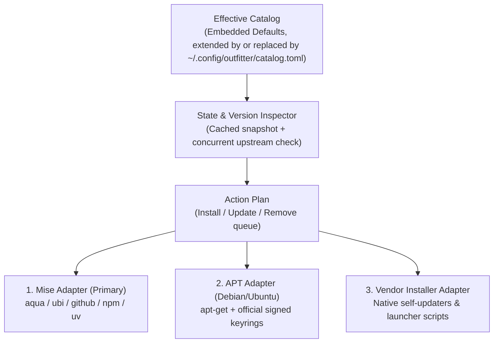

# Outfitter — Product and Technical Specification

- **Working name:** Outfitter (`outfitter`)
- **Status:** Draft v1
- **Date:** 2026-10-19
- **Platform:** Debian and Ubuntu Linux (`amd64`, `arm64`)
- **Interaction specification:** [TUI Experience & Interaction Specification](tui.md)
- **Interactive design reference:** [docs/mockups/index.html](../mockups/index.html)

---

## 1. Summary

**Outfitter** is a keyboard-first TUI and scriptable CLI for installing, inspecting, selecting, and bulk-updating the command-line tools and coding harnesses used for AI-assisted software development on Debian and Ubuntu Linux.

An AI development environment today spans incompatible installation channels: coding harnesses (`claude`, `codex`, `muse`, `agy`, `opencode`, `pi`, `gemini`, `copilot`), terminal workspaces (`tmux`, `hive`, `lazygit`), personal AI TUIs (`boardwalk`, `trailmark`, `quotary`, `codexbar`, `openclaw`, `mercadona-cli`), Python/uv agent tools (`browser-use`), and system utilities (`gh`, `fzf`, `delta`, `glow`, `ripgrep`, `fd`, `jq`, `btop`). Keeping these installed and updated across desktop workstations and headless Ubuntu servers requires remembering a half-dozen package managers, vendor scripts, and Node/Python runtime quirks.

Outfitter provides:
1. **A curated, extensible catalog** organized into four categories (**Coding Harnesses**, **AI TUIs & Personal Tools**, **Terminal & Session Management**, and **Agent & CLI Utilities**) with built-in selection profiles (**Full Desktop**, **Headless Server / VPS**, **Harnesses Only**, **Minimal**).
2. **A `mise`-backed installation engine** that auto-bootstraps `mise` into `~/.local/bin/mise` (with SHA-256 verification) when missing, using `mise` to manage GitHub releases (`aqua:` / `ubi:`), NPM global CLIs (`npm:`), Python tool environments (`pipx:` / `uv`), and language runtimes—so Node-based harnesses like `codex` and `pi` never disappear when switching project Node versions.
3. **Thin, explicit adapters** for the two places `mise` does not cover: Debian/Ubuntu `apt` packages (`tmux`, `gh`, `btop`) and self-managing vendor installers (`claude`, `muse`, `agy`, `opencode`).
4. **A two-phase Plan & Apply workflow**: select or deselect tools visually in the TUI, mark outdated tools for upgrade, inspect the exact commands that will run in a dry-run execution plan, and execute them with live per-tool progress and logs.

---

## 2. Goals and Non-Goals

### Goals (v1)
- **Zero-prerequisite bootstrap on Debian/Ubuntu:** Drop the standalone `outfitter` binary onto a fresh Ubuntu or Debian machine, run `outfitter`, and let it bootstrap `~/.local/bin/mise` and your chosen tools cleanly.
- **Visual selection and bulk updates:** Browse all catalog tools grouped by category, toggle individual tools (`Space`) or entire categories (`g`), apply preset profiles (`p`), mark all outdated tools for update (`u`), and review pending changes before execution (`a`).
- **Unified version and update discovery:** Detect installed binary path, installed version, and latest upstream version in the background without blocking startup. Borrow `gh auth token` when available to avoid GitHub API rate limits.
- **User-extensible catalog:** Ship an opinionated built-in catalog embedded in the binary while allowing users to bring their own catalog in `~/.config/outfitter/catalog.toml` (or via `--catalog`): *extend* the built-in catalog with custom tools, backend overrides, or custom profiles, or *replace* it entirely with a catalog of their own (`catalog init`, checked with `catalog validate` / `catalog show`).
- **Parity between TUI and CLI:** Every action in the TUI (`status`, `install`, `update`, `remove`, `apply`, `catalog`) works as a non-interactive CLI command with `--dry-run`, `--yes`, and `--json` for scripts and provisioning pipelines.

### Non-Goals (Deferred to v2)
- **Provider authentication and credential management:** Outfitter v1 verifies whether a binary is installed and up to date; it does not run `gh auth login`, `claude login`, or OIDC flows, nor does it inspect subscription quotas (which belongs to `quotary`). Readiness/auth doctor checks are deferred to v2.
- **Dotfile and editor configuration management:** Wiring `tmax` into `~/.tmux.conf` or `blog-ai.el` into `~/.emacs` is deferred to v2.
- **Non-Debian operating systems:** While `mise`-backed tools work on macOS and other Linux distributions, `apt` system package handling in v1 targets Debian and Ubuntu specifically.
- **Background daemon or silent auto-updates:** Outfitter never installs, upgrades, or removes software without explicit user confirmation in the TUI or `--yes` on the CLI.

---

## 3. Architecture & Backend Engine

Outfitter does not reinvent package downloading where `mise` / `aqua` already excel. Every catalog entry declares a `backend` that maps to one of three execution adapters:



### 3.1 Auto-Bootstrapping `mise`
When Outfitter starts and detects that `mise` is not on `PATH` (and not at `~/.local/bin/mise`):
1. The TUI displays a clear banner (or dedicated bootstrap prompt on first apply) offering to install `mise` to `~/.local/bin/mise`.
2. Outfitter downloads the official `mise` release tarball for the host architecture (`linux-x64` or `linux-arm64`), verifies its SHA-256 checksum against the official `SHASUMS256.txt` (and GPG signature when `gpg` is present), extracts `~/.local/bin/mise`, and sets `0755` permissions.
3. When invoking `mise` for `npm:` or `pipx:`/`uv` backends, Outfitter ensures `mise` has a managed Node LTS and `uv` runtime configured in an isolated global scope (`~/.config/mise/config.toml`) so global AI CLIs (`codex`, `pi`, `gemini-cli`, `openclaw`) have stable shims in `~/.local/share/mise/shims` (or `~/.local/bin`) and never vanish when a user changes Node versions in `nvm`.

### 3.2 Backend Adapters

| Backend Type | Identifier | How Install Works | How Update Works | How Uninstall Works |
| :--- | :--- | :--- | :--- | :--- |
| **Mise Registry / Aqua** | `mise:aqua` | `mise use --global aqua:<pkg>@latest` | `mise upgrade <pkg>` | `mise unuse --global <pkg>` |
| **Mise GitHub Release** | `mise:ubi` / `mise:github` | `mise use --global ubi:<owner>/<repo>@latest` | `mise upgrade <pkg>` | `mise unuse --global <pkg>` |
| **Mise NPM Global** | `mise:npm` | `mise use --global npm:<pkg>@latest` | `mise upgrade npm:<pkg>` | `mise unuse --global npm:<pkg>` |
| **Mise Python (`uv`)** | `mise:pipx` / `uv` | `uv tool install <pkg>` (via `mise x uv --`) | `uv tool upgrade <pkg>` | `uv tool uninstall <pkg>` |
| **Debian / Ubuntu APT** | `apt` | `sudo apt-get install -y <pkg>` (with optional repo keyring setup for `gh`) | `sudo apt-get install --only-upgrade -y <pkg>` | `sudo apt-get remove -y <pkg>` |
| **Vendor Native** | `vendor` | Runs verified vendor installer or downloads official bundle (`claude`, `muse`, `agy`, `opencode`, `codexbar`) | Runs native self-updater (`claude update`, `opencode upgrade`, `muse --update`) or replaces bundle | Removes binary and managed version directory (`~/.local/bin/<bin>`) |
| **Local Source Build** | `source` | Fallback for unreleased local repos (e.g., `quotary`): runs `go build` in configured `source_dir` and installs to `~/.local/bin` | Rebuilds from `source_dir` HEAD | Removes `~/.local/bin/<bin>` |

### 3.3 Handling Special Cases
- **`sudo` and interactive terminals:** Any plan containing `apt` actions clearly badges those steps with `[sudo]`. Before starting batch execution, Outfitter runs `sudo -v` via `tea.ExecProcess` (temporarily releasing the alt-screen if a password prompt is required) so background execution never hangs on a hidden stdin prompt.
- **`codexbar` resource bundle:** As documented in Quotary's specification, `codexbar` requires its companion resource bundle to stay beside the executable. Outfitter's `vendor` / archive installer extracts the full directory to `~/.local/share/outfitter/packages/codexbar/` and symlinks `~/.local/bin/codexbar` to it.
- **`muse` launcher vs. binary:** Meta's `muse` uses a bash OIDC launcher (`~/.local/bin/muse`) that downloads `muse-bin-<version>` after authentication and records state in `~/.local/bin/.muse-version` and `.muse-release-info.json`. Outfitter reads `.muse-version` directly to report the installed version without triggering an interactive OIDC login during status scans.
- **Unmanaged existing installations:** If a tool is already installed outside `mise` (for example, `codex` in `~/.nvm/...` or `hive` in `/usr/local/bin/hive`), Outfitter detects it via `PATH`, displays its location and version with an `external` provenance badge, and lets the user either keep it as-is or migrate/update it cleanly. Removing an `external` install deletes the discovered binary directly (the backend never owned it, so its uninstall command would be a no-op); removing an install owned by a *different* manager (e.g. an APT package for a `mise` tool) is blocked with an explanation instead of silently doing nothing.

---

## 4. Built-In Opinionated Catalog

Outfitter ships with 48 curated tools across 4 categories and 4 preset profiles. The embedded source of truth is `internal/catalog/default_catalog.toml`; `outfitter catalog show` reports the effective counts and `outfitter catalog export` prints the same catalog.

### Category 1: Coding Harnesses (`harnesses`)
| ID | Name | Binary | Backend | Default Profiles | Description |
| :--- | :--- | :--- | :--- | :--- | :--- |
| `claude-code` | Claude Code | `claude` | `vendor` (`anthropic/claude-code`) | `desktop`, `server`, `harnesses`, `minimal` | Anthropic agentic coding CLI with MCP servers, hooks, skills, and memory. |
| `codex` | OpenAI Codex CLI | `codex` | `mise:npm` (`@openai/codex`) | `desktop`, `server`, `harnesses`, `minimal` | OpenAI local coding agent CLI with session logs and reasoning controls. |
| `muse` | Muse Code | `muse` | `vendor` (`api.meta.ai/muse-code (muse-stable)`) | `desktop`, `server`, `harnesses` | Meta agentic coding CLI driving Wonder and Wonder Full models. |
| `antigravity-cli` | Antigravity CLI | `agy` | `vendor` (`google-deepmind/antigravity-cli`) | `desktop`, `server`, `harnesses` | Google DeepMind agentic coding assistant CLI (agy) with subagents and skills. |
| `opencode` | OpenCode v2 | `opencode` | `vendor` (`sst/opencode`) | `desktop`, `server`, `harnesses` | Terminal-native AI coding agent (v2) with multi-provider support. |
| `pi` | Pi Coding Agent | `pi` | `mise:npm` (`@earendil-works/pi-coding-agent`) | `desktop`, `harnesses` | Minimalist, hackable terminal coding harness by Earendil Works. |
| `gemini-cli` | Gemini CLI | `gemini` | `mise:npm` (`@google/gemini-cli`) | `desktop`, `harnesses` | Google open-source Gemini terminal coding agent. |
| `copilot-cli` | GitHub Copilot CLI | `copilot` | `mise:npm` (`@github/copilot`) | `desktop`, `harnesses` | GitHub Copilot agentic command-line assistant. |

### Category 2: AI TUIs & Personal Tools (`ai-tuis`)
| ID | Name | Binary | Backend | Default Profiles | Description |
| :--- | :--- | :--- | :--- | :--- | :--- |
| `boardwalk` | Boardwalk | `boardwalk` | `mise:ubi` (`juanrubio/boardwalk`) | `desktop`, `server`, `minimal` | Your GitHub Projects v2 boards in the terminal, powered by gh auth. |
| `trailmark` | Trailmark | `trailmark` | `mise:ubi` (`juanrubio/trailmark`) | `desktop`, `server`, `minimal` | Local keyboard-first TUI for browsing coding-agent sessions and saved memories. |
| `quotary` | Quotary | `quotary` | `mise:ubi` (`juanrubio/quotary`) | `desktop` | Go terminal dashboard for AI subscription capacity, reset times, and token history. |
| `codexbar` | CodexBar CLI | `codexbar` | `vendor` (`steipete/CodexBar`) | `desktop` | Provider allowance and usage reader CLI used as the backend for Quotary. |
| `mercadona-cli` | mercadona-cli | `mercadona` | `mise:npm` (`juanrubio/mercadona-cli`) | `desktop`, `server` | Agent-friendly CLI (--json) for Mercadona carts, orders, and checkout flows. |

### Category 3: Terminal & Session Management (`terminal`)
| ID | Name | Binary | Backend | Default Profiles | Description |
| :--- | :--- | :--- | :--- | :--- | :--- |
| `tmux` | tmux | `tmux` | `apt` (`tmux`) | `desktop`, `server`, `minimal` | Terminal multiplexer for persistent local and remote coding-agent sessions. |
| `byobu` | Byobu | `byobu` | `apt` (`byobu`) | `desktop`, `server` | Text-based window manager and terminal multiplexer wrapper for tmux. |
| `hive` | Hive | `hive` | `mise:ubi` (`mdipanjan/hive`) | `desktop`, `server` | Lightweight Bubble Tea TUI for managing and switching tmux sessions. |
| `herdr` | Herdr | `herdr` | `mise:aqua` (`herdrdev/herdr`) | `desktop`, `server` | Detachable terminal session runtime where coding agents live: split panes, walk away, reattach. |
| `gh` | GitHub CLI | `gh` | `apt` (`gh`) | `desktop`, `server`, `minimal` | GitHub official CLI; provides zero-storage OAuth tokens for Boardwalk and Outfitter. |
| `gh-dash` | gh-dash | `gh-dash` | `mise:aqua` (`dlvhdr/gh-dash`) | `desktop`, `server` | GitHub dashboard TUI for pull requests and issues, built as a GitHub CLI companion. |
| `lazygit` | Lazygit | `lazygit` | `mise:aqua` (`jesseduffield/lazygit`) | `desktop`, `server` | Simple terminal UI for git commands, interactive staging, and worktree inspection. |
| `fzf` | fzf | `fzf` | `mise:aqua` (`junegunn/fzf`) | `desktop`, `server`, `minimal` | Command-line fuzzy finder powering shell history and tmax session popups. |
| `delta` | git-delta | `delta` | `mise:aqua` (`dandavison/delta`) | `desktop`, `server` | Syntax-highlighting pager for git, diff, and grep output. |
| `glow` | Glow | `glow` | `mise:aqua` (`charmbracelet/glow`) | `desktop` | Render Markdown specs, PRDs, and agent memory files on the CLI. |
| `ripgrep` | ripgrep | `rg` | `mise:aqua` (`BurntSushi/ripgrep`) | `desktop`, `server`, `minimal` | Recursively searches directories for a regex pattern at high speed. |
| `fd` | fd | `fd` | `mise:aqua` (`sharkdp/fd`) | `desktop`, `server` | Fast, user-friendly alternative to find used by coding harnesses. |
| `jq` | jq | `jq` | `mise:aqua` (`jqlang/jq`) | `desktop`, `server`, `minimal` | Lightweight and flexible command-line JSON processor. |
| `btop` | btop | `btop` | `apt` (`btop`) | `desktop`, `server` | Resource monitor showing usage and stats for processor, memory, disks, and processes. |
| `zoxide` | zoxide | `zoxide` | `mise:aqua` (`ajeetdsouza/zoxide`) | `desktop`, `server`, `minimal` | Smarter cd command inspired by z and autojump that learns your most used directories. |
| `eza` | eza | `eza` | `mise:aqua` (`eza-community/eza`) | `desktop`, `server` | Modern, maintained replacement for ls and exa with Git status and tree views. |
| `bat` | bat | `bat` | `mise:aqua` (`sharkdp/bat`) | `desktop`, `server` | Cat clone with syntax highlighting, Git integration, and fzf preview support. |
| `dust` | dust | `dust` | `mise:aqua` (`bootandy/dust`) | `desktop`, `server` | Intuitive disk usage analyzer in Rust; visual replacement for du. |
| `broot` | broot | `broot` | `mise:github` (`broot`) | `desktop`, `server` | Interactive directory tree navigator and fuzzy file manager. |
| `tig` | tig | `tig` | `apt` (`tig`) | `desktop`, `server` | Ncurses text-mode interface for Git repositories and commit history. |
| `htop` | htop | `htop` | `apt` (`htop`) | `desktop`, `server` | Interactive process viewer and system monitor. |
| `porthole` | Porthole | `porthole` | `mise:github` (`subh05sus/porthole`) | `desktop`, `server` | Port kill switch and service viewer for the terminal: see what is listening and stop it, project-aware. |

### Category 4: Agent & CLI Utilities (`utilities`)
| ID | Name | Binary | Backend | Default Profiles | Description |
| :--- | :--- | :--- | :--- | :--- | :--- |
| `browser-use` | browser-use | `browser-use` | `uv` (`browser-use`) | `desktop` | AI browser automation CLI and TUI (provides browser-use, browser-use-tui, bu). |
| `openclaw` | OpenClaw | `openclaw` | `mise:npm` (`openclaw`) | `desktop`, `server` | Open-source personal AI assistant and tmux worker coordinator (Galactus & Sam). |
| `mcporter` | MCPorter | `mcporter` | `mise:npm` (`mcporter`) | `desktop` | CLI utility for inspecting, testing, and managing MCP server configurations. |
| `oracle` | Oracle | `oracle` | `mise:npm` (`@steipete/oracle`) | `desktop` | Second-opinion architectural review CLI for coding agents. |
| `summarize` | Summarize | `summarize` | `mise:npm` (`@steipete/summarize`) | `desktop` | Fast URL, article, and transcript summarizer CLI for agent pipelines. |
| `wacli` | wacli | `wacli` | `mise:ubi` (`steipete/wacli`) | `desktop`, `server` | WhatsApp CLI bridge used by OpenClaw personal agents. |
| `twitter-cli` | Twitter CLI | `twitter` | `uv` (`twitter-cli`) | `desktop`, `server` | Twitter/X CLI for feed, bookmarks, and user timelines in the terminal. |
| `hcloud` | Hetzner Cloud CLI | `hcloud` | `mise:aqua` (`hetznercloud/cli`) | `desktop`, `server` | Official Hetzner Cloud CLI for managing remote VPS agent instances. |
| `aws-cli` | AWS CLI | `aws` | `mise:aqua` (`aws/aws-cli`) | `desktop`, `server` | Official Amazon Web Services CLI v2 for managing AWS accounts and resources. |
| `cloudflare-cf` | Cloudflare CLI | `cf` | `mise:npm` (`cf`) | `desktop`, `server` | Cloudflare's unified CLI (cf) for DNS, Workers, and account resources. |
| `wrangler` | Wrangler | `wrangler` | `mise:npm` (`wrangler`) | `desktop`, `server` | Cloudflare Workers CLI to build, preview, and deploy Workers and Pages. |
| `tailscale` | Tailscale | `tailscale` | `apt` (`tailscale`) | `desktop`, `server` | WireGuard-based mesh VPN CLI; requires the Tailscale APT repo and a one-time tailscale up login. |
| `visidata` | VisiData | `vd` | `uv` (`visidata`) | `desktop`, `server` | Interactive terminal spreadsheet and tabular data explorer for CSV, JSONL, and SQLite. |

---

## 5. User Catalog & Configuration (`catalog.toml`)

Users can inspect, extend, or replace the catalog in `~/.config/outfitter/catalog.toml`. A user catalog may start with a self-describing header:

```toml
[catalog]
schema_version = 1
mode = "extend"        # or "replace"
name = "Workstation"   # optional
```

`schema_version` defaults to 1 and must be positive and no newer than this build supports. `mode` is case-insensitive. A file without a header (or without `mode`) is an *extend* catalog, so overlays written before headers existed keep working. Header-bearing files are validated strictly: unknown keys anywhere in the document are rejected.

### 5.1 Composition Rules

**Extend mode** merges the user file over the embedded catalog:

1. Outfitter loads its embedded default catalog first.
2. If `~/.config/outfitter/catalog.toml` exists, Outfitter merges it by tool `id`:
   - Matching `id`: overrides any specified fields (e.g., pinning a `version`, changing `backend` from `mise:ubi` to `source`, or adding it to a profile). Setting `disabled = true` hides a built-in tool.
   - New `id`: appends the user's custom tool to the specified `category` (inferred when undeclared, `utilities` by default).
3. Deleting an entry from an extend catalog only removes the override; the built-in value returns. `disabled = true` is how a built-in tool is hidden in extend mode.

**Replace mode** makes the user file the entire catalog:

1. Loading starts from an empty catalog with only field-wise settings defaults. Built-in tools, categories, and profiles — and unspecified fields of same-`id` built-ins — are never inherited.
2. The document uses the same grammar as extend mode (`[settings]`, `[[categories]]`, `[[tools]]`, and profiles as `[profiles.<name>]` tables or `[[profiles]]` entries). Categories may be inferred from tools and profiles may be omitted entirely; tools get the same default name, category, version arguments, and derived backend commands as custom extend tools.
3. Deleting an entry deletes it. Validation is strict: duplicate or invalid IDs, missing `binary`/`backend`, invalid `version_regex`, missing `package` for `mise`/`uv`/`apt` tools, `source` tools with neither `source_dir` nor `build_cmd`, `vendor` tools without effective install/update/remove commands, dangling profile↔tool references, an empty `install_dir`, and a catalog with zero active tools are all errors.

Selection and recovery:

- Users can pass `--catalog /path/to/catalog.toml` to share team or machine-specific catalogs in a dotfiles repo (or symlink a dotfiles file to the default path).
- `catalog init` writes a replacement catalog seeded from the complete built-in catalog; `--blank` writes an unusable-until-edited skeleton, `--extend` writes a no-op overlay, and `--output`/`--force` (keeping a `.bak` backup) control placement.
- `catalog show` reports the effective catalog's name, schema, mode, origin, path, and counts; `catalog validate [path]` checks a file without inspecting tools; `catalog export` prints the raw embedded catalog (which, having no header, would load as an extend overlay if saved as a user catalog).
- A malformed user catalog is an error, never a silent fallback. `catalog init`/`validate`/`export` remain usable to repair it, and `--ignore-user-catalog` runs against the built-in catalog alone. `--catalog` together with `--ignore-user-catalog` is a usage error (exit 2).

### 5.2 Example `~/.config/outfitter/catalog.toml`
```toml
# Optional: override settings
[settings]
install_dir = "~/.local/bin"
auto_bootstrap_mise = true
github_token_from_gh = true
self_update_check = true

# Override a built-in tool to build from local source while developing
[[tools]]
id = "quotary"
backend = "source"
source_dir = "~/repos/quotary"
build_cmd = "go build -o ~/.local/bin/quotary ./cmd/quotary"

# Add a new custom tool to the catalog
[[tools]]
id = "ttyd"
name = "ttyd"
category = "terminal"
binary = "ttyd"
backend = "mise:ubi"
package = "tsl0922/ttyd"
version_args = ["--version"]
version_regex = 'ttyd version ([0-9.]+)'
profiles = ["desktop", "server"]
description = "Share terminal sessions over the web"

# Define a custom profile
[profiles.vps-worker]
name = "VPS Worker"
description = "Headless agent worker for Hetzner VPS"
tools = ["tmux", "gh", "claude-code", "codex", "openclaw", "boardwalk", "ripgrep", "jq"]
```

---

## 6. State & Cache Lifecycle

- **Instant startup from snapshot:** Outfitter stores the last known tool state and upstream version cache at `~/.cache/outfitter/state.json`. Launching `outfitter` paints the screen immediately in `<50 ms` using cached version readings plus fast local `exec.LookPath` checks, then refreshes installed and upstream versions asynchronously in the background.
- **Self-update check cache:** The latest known Outfitter release and check time live separately at `~/.cache/outfitter/self-check.json`. Background checks run at most once per 24 hours, are recomputed against the currently running binary version, and can be disabled with `[settings] self_update_check = false` or `OUTFITTER_NO_UPDATE_CHECK=1`. Development builds and demo mode never check.
- **No silent mutations:** Selecting or deselecting checkboxes in the TUI mutates an in-memory **Pending Action Plan** (`+N install`, `↑N update`, `-N remove`). Nothing on disk is modified until the user presses `a` (`Apply`) and confirms on the Plan Review modal.
- **Execution logs:** Every apply run records structured command output and exit codes in `~/.local/state/outfitter/logs/run-<timestamp>.log` so failed installations can be inspected or copied right from the TUI.

---

## 7. CLI Contract

While `outfitter` with no arguments opens the interactive TUI, the CLI provides scriptable subcommands with deterministic exit codes:

```sh
outfitter                                  # Open the interactive TUI
outfitter status [--json]                  # List all catalog tools, installed versions, and available updates
outfitter check [--json]                   # Check upstream registries for available updates
outfitter doctor [--fix] [--shims] [--dry-run] [--yes] [--json]  # Diagnose/fix mise shell integration (bash/zsh)
outfitter profile list                     # List built-in and custom profiles
outfitter profile apply <name> [--dry-run] [--yes]  # Install all tools in a profile (e.g., server, desktop)
outfitter install <tool-id>... [--dry-run] [--yes] [--remove-strays]  # Install specific tools
outfitter update [<tool-id>...] [--all] [--dry-run] [--yes] [--remove-strays]  # Bulk-update outdated tools
outfitter remove <tool-id>... [--dry-run] [--yes]   # Uninstall specific tools
outfitter self-update [--check|--dry-run] [--yes] [--json]  # Check for or install a newer Outfitter release
outfitter catalog init [--blank|--extend] [--output <path>] [--force]  # Write a starter user catalog (seeded replacement by default)
outfitter catalog show [--json]            # Show the effective catalog's mode, origin, path, and counts
outfitter catalog validate [<path>] [--json]  # Validate a catalog (exit 1 when invalid, 2 on usage errors)
outfitter catalog export > catalog.toml    # Print the raw built-in catalog
outfitter --ignore-user-catalog status     # Bypass a broken user catalog and use the built-in catalog
```

### Self-Update

Outfitter is not a catalog tool. A dedicated self-state compares the running binary's build-time version with GitHub's latest non-prerelease `juanrubio/outfitter` release, so extend and replacement catalogs cannot hide or redefine it:

- `status` displays the cached self-update notice without network I/O. Its `--json` output remains the catalog entries array for compatibility.
- `check` forces a self-check alongside tool upstream checks and reports Outfitter separately; `--json` adds a `self` object while tool `updates` and `outdated_count` remain catalog-only.
- `self-update --check` reports only; `--dry-run` shows the provenance-specific method; a confirmed update requires an interactive confirmation or `--yes` (JSON execution also requires `--yes`).
- Mise-managed binaries update with `mise use --global ubi:juanrubio/outfitter[exe=outfitter]@<latest>` and are verified through `mise which`. Writable standalone Linux/macOS `amd64`/`arm64` binaries download the matching release asset and `SHA256SUMS`, verify the digest and downloaded `--version`, keep a `<binary>.previous` backup, atomically replace the resolved binary, verify it again, and roll back on verification failure.
- Read-only/system locations, unsupported platforms, and development builds are report-only with a manual-download hint. A successful update always requires restarting Outfitter; the running process keeps the old version and catalog.

### Exit Codes
- `0`: Success (all requested actions or checks succeeded).
- `1`: Partial or complete execution failure (at least one tool failed to install/update; summary states which succeeded and which failed).
- `2`: Usage error or confirmation refused (e.g., non-interactive pipe without `--yes`).

---

## 8. Implementation Stages & Acceptance Criteria

1. **Stage 1 — Catalog & State Discovery:**
   - Parse embedded default catalog + user `catalog.toml` overrides.
   - Detect `mise` status, local binary paths, installed versions, and provenance (`mise`, `apt`, `vendor`, `external`).
   - Query upstream versions (`mise ls-remote`, GitHub Releases API via `gh auth token` when present, NPM registry) with bounded concurrency and local caching.
2. **Stage 2 — Interactive TUI (Browse, Select, Filter, Plan):**
   - Implement the two-column master-detail layout (`120×40`+) and compact single-pane layout (`80×24`).
   - Support category grouping, individual toggle (`Space`), group toggle (`g`), profile selector (`p`), mark-all-updates (`u`), filter (`f`), search (`/`), and the dry-run Plan & Apply modal (`a`).
3. **Stage 3 — Execution Engine (`mise` Bootstrap + Adapters):**
   - Implement verified `mise` bootstrapper (`~/.local/bin/mise`).
   - Implement `mise`, `apt` (with `tea.ExecProcess` `sudo -v` handoff), `vendor`, and `source` adapters with live streaming progress and per-tool failure isolation.
4. **Stage 4 — Non-Interactive CLI & Verification:**
   - Wire `status`, `check`, `install`, `update`, `remove`, `profile apply`, and `catalog export` with `--dry-run`, `--yes`, and `--json`.
   - Pass `make check` (vet, linter, offline unit and fixture tests) and VHS tape verification.
